## Why libraries?

:::{.center}
Code re-use
:::

{fig-align="center" width="80%"}

## When use libraries?

<br>

:::{.center}
Code already exists to solve problem

- Tabular data analysis
- Plotting


:::{.small}
{fig-align="center" width="400px"}

{fig-align="center" width="400px"}

:::
:::

## Library utility function

<br>

:::{.center}
$$
\text{utility}_{\text{library}} = f(\text{trust}\uparrow, \text{time}\downarrow, \text{necessity}\uparrow)
$$
:::

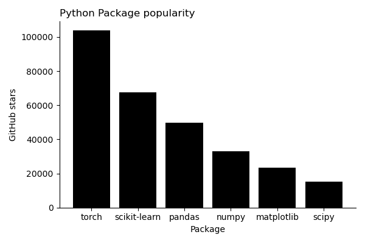{fig-align="center" width="80%"}

## When develop library?

<br>

:::{.center}
- Expect high re-use
- No existing solutions
- Existing solutions have problems: missing feature, slow, etc.
- Learning; libraries abstract algorithms and data structures away from user
- Examples: [CLI game](https://github.com/jakekrol/aibou), [Compbio](https://github.com/jakekrol/jkbiolib), [Gene fusions](https://github.com/jakekrol/genefusion)
:::

## How develop library?

:::{.center}
You are probably already writing library code

<br>

- Functions and classes are primary library components
- Start small: file = "module"
- Group similar code: directory = "package"
:::

## Libraries are composed of modules

<br>

<br>

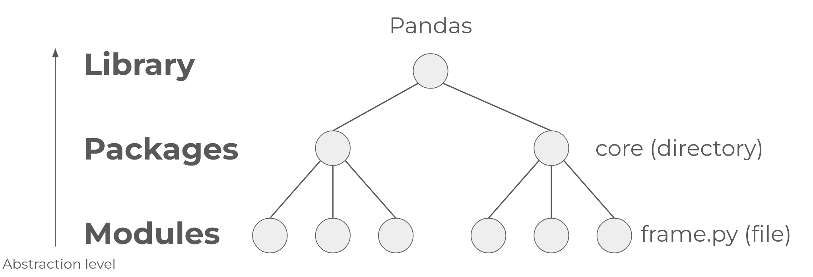{fig-align="center"}

## Library building tools

:::{.center}

<br>

UV, Twine, Pip, etc.


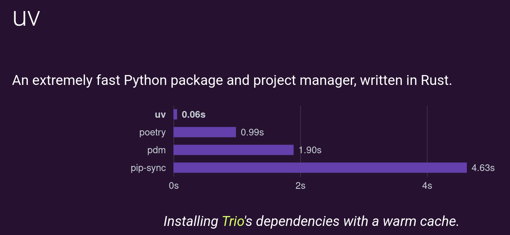{fig-align="center"}

:::

## Table of contents

<br>

:::{.center}
- [Numpy](#numpy)
- [Pandas](#pandas)
- [Matplotlib](#matplotlib)
- [Scikit-learn](#scikit-learn)
- [Torch](#torch)
:::

## Numpy

<br>

:::{.center}
Arrays, random number generation, & numerical analysis
:::

<br>

:::{.small}
{fig-align="center" width="400px"}
:::

## Basics

<br>

<br>

``` python
x = np.array([1,2,3,4]) # init
x ** 2 # operate
print(x.shape, x.ndim) # inspect shape
np.save("data.npy", x) # write, use npz for multiple arrays
np.load("data.npy") # read
```

## Poisson approximation of binomial

$$
p(x;\lambda) = \frac{\lambda^x e^{-\lambda}}{x!}
$$

$$
p(x;n,p) = \binom{n}{x} p^x (1-p)^{n-x}
$$

$$
\text{if } (\lambda = n\cdot p \text{ } \land \uparrow n \text{ }\land \downarrow p) \rightarrow p(x; \lambda)  \approx p(x;n,p)
$$


## Comparing vectors

:::{.center}
:::{.small}


``` python
import numpy as np; import pandas as pd; import matplotlib.pyplot as plt; np.random.seed(0)
m=10000
def distance(a,b):
    d_euc = np.linalg.norm(a - b, ord=None) # 2-norm: preserves units (e.g., meters)
    d_cos = 1 - ( np.dot(a, b) / (np.linalg.norm(a) * np.linalg.norm(b)) ) # cosine: unit less. normalized to [0,2].
    d_inf = np.linalg.norm(a-b,ord=np.inf) # infinity norm: preserves units. worst case analysis
    return d_euc, d_cos, d_inf
### weak approximation (n small, pr large)
trials1,pr_success1 = (50,0.90)
a_weak = np.random.binomial(n=trials1,p=pr_success1,size=m) # is sunny CO day? independence assumed
lam1 = trials1 * pr_success1
b_weak = np.random.poisson(lam=lam1,size=m)
weak = distance(a_weak,b_weak)
### strong approximation (n large, pr small)
trials2,pr_success2 = (100_000_000, 0.001) # does experiment succeed?
a_strong = np.random.binomial(n=trials2,p=pr_success2,size=m)
lam2 = trials2 * pr_success2
b_strong = np.random.poisson(lam=lam2,size=m)
strong = distance(a_strong,b_strong)
df = pd.DataFrame({'Weak': weak, 'Strong': strong}); df.index = ['Euc', 'Cos', 'Inf']; df = df.T
df['n'] = [trials1, trials2]; df['p'] = [pr_success1, pr_success2]; df['lambda'] = [lam1,lam2]
fig,ax=plt.subplots(nrows=1,ncols=2,figsize=(9,4))
ax[0].hist(a_weak,alpha=0.5,color='blue',bins=30); ax[0].hist(b_weak,alpha=0.5,color='yellow',bins=30); ax[0].spines['top'].set_visible(False); ax[0].spines['right'].set_visible(False); ax[0].set_title("Weak",loc="left")
ax[1].hist(a_strong,alpha=0.5,color='blue',bins=30); ax[1].hist(b_strong,alpha=0.5,color='yellow',bins=30); ax[1].spines['top'].set_visible(False); ax[1].spines['right'].set_visible(False); ax[1].set_title("Strong",loc="left")
plt.tight_layout(); plt.savefig("img/poission_approx_binom-hist.png"); plt.close()
```

|        | Euc      | Cos      | Inf    | n         | p     | lambda |
|--------|----------|----------|--------|-----------|-------|--------|
| Weak   | 700.61   | 0.011961 | 28.00  | 50        | 0.900 | 45.0   |
| Strong | 44447.0  | 0.000010 | 1539.0 | 100000000 | 0.001 | 100000 |
:::
:::

## Numerical experiment

<br>

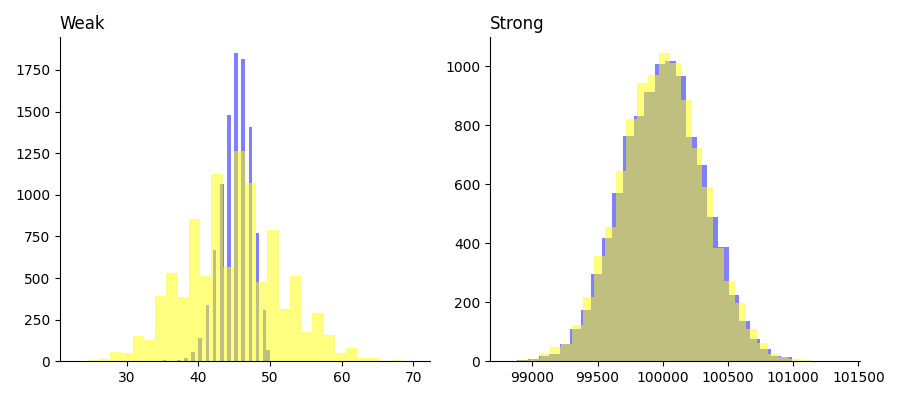{fig-align="center"}


## Distance metrics

<br>

$$
L_2=\sqrt{(a_1-b_1)^2 + (a_2-b_2)^2 + \ldots + (a_n-b_n)^2} = ||a-b||_2
$$

$$
L_\infty = max_{i\in \{1,\ldots,n\} }{|a_i - b_i|}
$$

$$
d_{\text{cos}} = 1 - \frac{a\cdot b}{||a||_2 \cdot ||b||_2}
$$

## Distance metrics

:::{.center}
Vector distances are common in optimization

| Metric | Preserves units? | Application |
|--------|----------|----------|
| Euclidean ($L_2$) | Yes | clustering (e.g., K-nearest neighbors) |
| $L_{\infty}$ | Yes | Worst case analysis (e.g., quality control) |
| Cosine   | No | Normalized similarity (e.g., embeddings of images) |
:::


## Pandas

<br>

:::{.center}
Tabular data analysis
:::

<br>

:::{.small}
{fig-align="center" width="400px"}
:::

## Basics

<br>

<br>

```python 
import pandas as pd
df_gene = pd.read_csv("data/gene_expression.tsv",sep="\t") # read tsv file to dataframe obj
df_gene.head(5) # show first 5 rows
df_gene.iloc[2,4] # locate value (3rd row, 5th column)
cols_sum=df_gene.columns.tolist()[1:] # get columns
df_gene['total_expression'] = df_gene[cols_sum].sum(axis=1) # row-wise sum
```

## Relating two tables


<br>

:::{.center}

```python
import pandas as pd
# left join two tables with shared key = "sample"
df_gene = pd.read_csv("data/gene_expression.tsv",sep="\t") # 100 x 1001
df_sample = pd.read_csv("data/sample_conditions.tsv",sep="\t") # 50 x 5
df_merge = pd.merge(df_gene, df_sample, how="left", on="sample") # 100 x 1005
df_merge.isna().sum(axis=0) # NA values per column
mask = df_merge.isna() # 100 x 1005 bool
df_merge[mask] = 0 # replace NAs with 0
df_merge.describe() # column-wise stats: min, q1, median, q3, max, mean, etc.
```

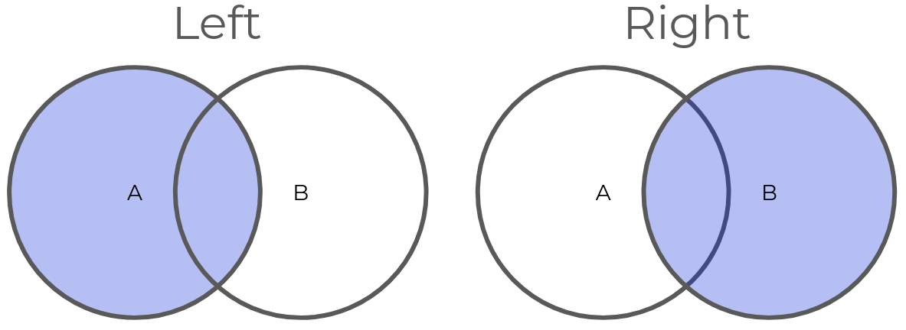{fig-align="center" width="50%"}

:::

## Operations applied to sub-groups

<br>

<br>

```python
import pandas as pd; import seaborn as sns
df = sns.load_dataset("tips") # total_bill,tip,sex,smoker,day,time,size
df.groupby('smoker')['tip'].mean() # 2 groups
df.groupby(['smoker', 'sex'])['tip'].mean() # 4 groups
# iterate and operate on groups
tip_percents = dict()
for key, df_group in df.groupby('smoker'):
    tip_percents[key] = round((df_group['tip'] / df_group['total_bill']).mean(),4)
# {'Yes': 0.1632, 'No': 0.1593}
```


## Matplotlib

<br>

<br>


``` python
import matplotlib.pyplot as plt; import numpy as np; np.random.seed(0); size=10_000
x=np.random.binomial(n=100,p=0.5,size=size)
y= (2 * x) + np.random.normal(0,10, size=size)
z=np.random.choice([0,1],size=size,replace=True, p=[0.8,0.2])
plt.scatter(x,y, s=1); plt.show() # interactive, s = dot size
plt.close() # close figure
fig, ax = plt.subplots(nrows=1,ncols=2) # multiple plots in a grid
ax[0].bar(x=[0,1], height = [sum(z==0), sum(z==1)])
ax[1].hist(x,bins=30)
plt.savefig("bar-hist.png") # write to file
plt.close()
```

## Discrete distributions

:::{.center}
:::{.small}

``` python
import matplotlib.pyplot as plt
import numpy as np
mean,bins,size=100,30,10000; color='black'
x_binom=np.random.binomial(n=1000,p=0.1,size=size); smean_binom=np.mean(x_binom)
x_poisson=np.random.poisson(lam=mean,size=size); smean_poisson=np.mean(x_poisson)
x_geom=np.random.geometric(p=0.01,size=size); smean_geom=np.mean(x_geom)
x_uniform=np.random.randint(0,201,size=size); smean_uniform=np.mean(x_uniform)
fig,ax=plt.subplots(2,2,figsize=(6,4))
ax[0,0].hist(x_binom,bins=bins,color=color); ax[0,0].axvline(smean_binom,color='red',linestyle='--')
ax[0,0].set_title(r'Binomial($n=1000,p=0.1$)',loc='left')
ax[0,1].hist(x_poisson,bins=bins,color=color); ax[0,1].axvline(smean_poisson,color='red',linestyle='--',label='sample mean')
ax[0,1].set_title('Poisson',loc='left')
ax[1,0].hist(x_geom,bins=bins,color=color); ax[1,0].axvline(smean_geom,color='red',linestyle='--')
ax[1,0].set_title('Geometric',loc='left')
ax[1,1].hist(x_uniform,bins=bins,color=color); ax[1,1].axvline(smean_uniform,color='red',linestyle='--')
ax[1,1].set_title('Discrete uniform',loc='left')
fig.legend(loc='upper right'); fig.tight_layout(); fig.savefig('img/discrete_dists.png',dpi=150)
```

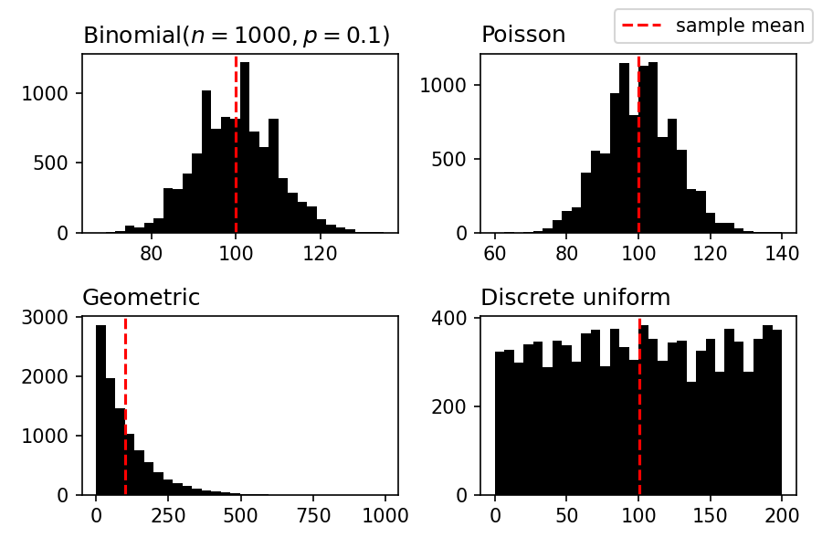{fig-align="center" width="40%"}

:::
:::

## Scikit-learn

<br>

:::{.center}
Train and evaluate established ML models
:::

<br>

:::{.small}
{fig-align="center" width="400px"}
:::

## Classification 

:::{.small}
:::{.center}

<br>

``` python
from sklearn.model_selection import train_test_split;  from sklearn.neighbors import KNeighborsClassifier; from sklearn.metrics import confusion_matrix
import numpy as np; import pandas as pd; import matplotlib.pyplot as plt; np.random.seed(0)
ftr_group1 = np.random.poisson(20,size=50) # e.g., BMI
ftr_group2 = np.random.normal(30,size=50)
outcome_group1 = np.random.choice([0,1],replace=True,p=[0.9,0.1],size=50) # biased toward 0
outcome_group2 = np.random.choice([0,1],replace=True,p=[0.1,0.9], size=50) # biased toward 1
ftr = np.concatenate([ftr_group1, ftr_group2]); outcome = np.concatenate([outcome_group1, outcome_group2])
x_train, x_test, y_train, y_test = train_test_split(
    ftr, outcome, test_size=0.2, train_size=0.8, random_state=0, shuffle=True)
knn = KNeighborsClassifier(n_neighbors=3,algorithm='brute',p=2,metric='minkowski',n_jobs=1)
knn.fit(x_train.reshape(-1,1),y_train) # .reshape(-1,1) specifies there is only 1 column to be expected; sklearn expects matrix like shape, not vector for features
y_test_pred = knn.predict(x_test.reshape(-1,1))
confusion_matrix(y_test,y_test_pred)
```

<br>

|  | Prediction=0 | Prediction=1 |
|---|---:|---:|
| **Truth=0** | 8 | 1 |
| **Actual=1** | 3 | 8 |

:::
:::

<!-- # fig,ax = plt.subplots(nrows=1,ncols=2,figsize=(6,4))
# ax[0].scatter(x_train + np.random.normal(0,0.1), y_train + np.random.normal(0,0.05,size=len(y_train)), color = 'black',s=3)
# ax[0].set_xlabel("BMI"); ax[0].set_ylabel("Disease"); ax[0].spines['top'].set_visible(False); ax[0].spines['right'].set_visible(False)
# cmap = {0:'red',1:'black'}
# ax[1].scatter(x_test + np.random.normal(0,0.1), y_test_pred + np.random.normal(0,0.05,size=len(y_test)), color = [cmap[y_test[i]==y_test_pred[i]] for i in range(len(y_test))],s=3)
# ax[1].set_xlabel("BMI"); ax[1].set_ylabel("Disease"); ax[1].spines['top'].set_visible(False); ax[0].spines['right'].set_visible(False)
# plt.tight_layout(); plt.savefig('img/knn_classifier.png') -->


## Regression

:::{.center}
:::{.small}

``` python
# predict rural population size, given CO2 emissions
from sklearn.linear_model import LinearRegression
import pandas as pd; import numpy as np; import matplotlib.pyplot as plt; np.random.seed(0)
df = pd.read_csv("data/agrofood_co2_emission.csv"); TARGET="Rural population"
years = [2019, 2020]; mask = df['Year'].isin(years); df = df[mask] # i confirmed all remaining areas have both 2019 and 2020 data `df['Area'].value_counts().value_counts()`
areas_test = set(np.random.choice(df['Area'].unique(),replace=False, size=int( np.floor( len( df['Area'].unique() ) // 4 ) ) ) )
areas_train = set(df[~df['Area'].isin(areas_test)]['Area'].unique())
df_test = df[df['Area'].isin(areas_test)]; df_train = df[df['Area'].isin(areas_train)]
mask = df_test['Year'] == 2020; y_test = df_test[mask][TARGET]; mask = df_train['Year'] == 2020; y_train = df_train[mask][TARGET]
features = list(set(df.columns) - {'Year', TARGET, 'Area', 'Urban population', 'Total Population - Female', 'Total Population - Male', 'Average Temperature °C', 'total_emission'})
mask = df_test['Year'] == 2019; x_test = df_test[mask][features]; mask = df_train['Year'] == 2019; x_train = df_train[mask][features]
x_test = x_test.fillna(x_train.mean()); x_train = x_train.fillna(x_train.mean()) # use means from train only to fill
model = LinearRegression().fit(x_train,y_train); print(f"# weights: {list(zip(x_train.columns,model.coef_))}")
y_pred = model.predict(x_test)
mse = sum( (y_test - y_pred)**2 ) / len(y_test); rmse = np.sqrt(mse); r2_train = model.score(x_train,y_train); r2_test = model.score(x_test,y_test)
fig,ax = plt.subplots(figsize=(5,5))
ax.scatter(y_test,y_pred, s=2, color='black'); ax.spines['top'].set_visible(False); ax.spines['right'].set_visible(False); ax.plot([10**i for i in range(1,10)], [10**i for i in range(1,10)], linestyle='--')
ax.text(x=0.5,y=0.85,s=f"log10(RMSE)={round(np.log10(round(rmse)), 2)}",transform=ax.transAxes)
ax.set_xscale('log'); ax.set_yscale('log'); ax.set_xlabel("Test rural pop. (2020)"); ax.set_ylabel("Pred. rural pop. (2020)");
ax.set_title('Linear regression',loc='left'); plt.tight_layout(); plt.savefig("img/rural_pop_regression.png")
```

::::{.columns}
:::{.column width="50%"}
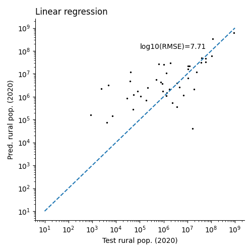{fig-align="center" width="45%"}
:::
:::{.column width="50%"}
| Feature | Beta |
|---|---:|
| On-farm Electricity Use (max) | 2114.4020 |
| Pesticides Manufacturing (min) | -7646.2649 |
:::
::::

:::
:::

## Clustering

:::{.center}
:::{.small}

``` python
from sklearn.cluster import KMeans
import pandas as pd; import numpy as np; import matplotlib.pyplot as plt
df = pd.read_csv("data/agrofood_co2_emission.csv")
columns = ['Rice Cultivation', 'Fertilizers Manufacturing', 'Year']
df = df[columns]
df = df.dropna()
df = df[df['Year'] == 2020] # 1 area per year
x = df[['Rice Cultivation', 'Fertilizers Manufacturing']]
fig,ax = plt.subplots(nrows=1,ncols=3,figsize=(12,4))
for i,k in enumerate([3,5,7]):
    model = KMeans(n_clusters=k, init='k-means++')
    cluster_labels = model.fit_predict(x)
    ax[i].scatter(x['Rice Cultivation'], x['Fertilizers Manufacturing'], c=cluster_labels, cmap='tab10', s = 1)
    ax[i].set_xlabel('Rice cultivation emissions (ktons)'); ax[i].set_ylabel('Fertilizers manufacturing emissions (ktons)')
    ax[i].spines['top'].set_visible(False); ax[i].spines['right'].set_visible(False)
    ax[i].set_title(f"K={k}"); ax[i].set_xscale('log'); ax[i].set_yscale('log')
fig.tight_layout(); fig.savefig('img/agriculture_clustering.png')
```

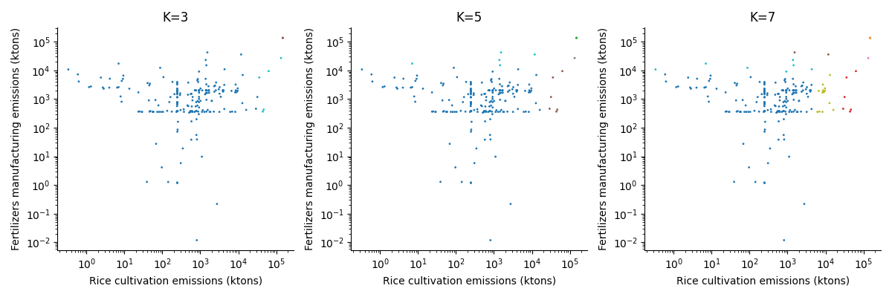{fig-align="center" width="70%"}

:::
:::

## K-means objective

:::{.center}

<br>

Minimize total squared distances to cluster centers

<br>

$$
\sum_{c\in K} \sum_{i=1}^n ||x_i - \mu_c ||_2^2
$$

:::

## Torch

:::{.center}

<br>

Deep learning

:::{.small}

<br>

{fig-align="center" width="200px"}

:::
:::

## Feed-forward NN

:::{.small}

``` python
# rural pop. regression
# x_train, x_test, y_train, y_test are from sklearn linear regression code block
import torch; from torch import nn; from torch.utils.data import TensorDataset, DataLoader
torch.manual_seed(0); torch.use_deterministic_algorithms(True) # still not deterministic
x_train = torch.tensor(x_train.values, dtype=torch.float32)
y_train = torch.tensor(y_train.values, dtype=torch.float32).reshape(-1,1)
x_test = torch.tensor(x_test.values, dtype=torch.float32)
y_test = torch.tensor(y_test.values, dtype=torch.float32).reshape(-1,1)
train_loader=DataLoader(TensorDataset(x_train,y_train), batch_size=x_train.shape[0] // 10, shuffle=True, generator=torch.Generator().manual_seed(0))
dim_input=x_train.shape[1]; dim_h1 = 5;
model=torch.nn.Sequential(nn.Linear(dim_input, dim_h1),nn.ReLU(),nn.Linear(dim_h1,1))
optimizer=torch.optim.Adam(model.parameters(),lr=1e-3)
loss_fn=nn.MSELoss()
model.train() # train mode (update weights)
epoch_losses = []
for epoch in range(1000):
    batch_losses = []
    for x, y in train_loader:
        optimizer.zero_grad() # reset gradient per batch
        loss=loss_fn(model(x), y)
        loss.backward() # compute gradient
        optimizer.step() # apply weight updates
        batch_losses.append(loss.item())
    epoch_losses.append(np.mean(batch_losses))
# eval mode, no gradients computed
model.eval()
with torch.no_grad():
    y_pred = model(x_test)
mse = torch.mean((y_test-y_pred)**2).item(); rmse = np.sqrt(mse) # .item() convert tensor scalar to py scalar
fig,ax = plt.subplots(figsize=(5,5)); ax.scatter(y_test,y_pred, s=2, color='black'); ax.spines['top'].set_visible(False); ax.spines['right'].set_visible(False); ax.plot([10**i for i in range(1,10)], [10**i for i in range(1,10)], linestyle='--')
ax.text(x=0.5,y=0.8,s=f"log10(RMSE)={round(np.log10(round(rmse)),2)}",transform=ax.transAxes)
transform=ax.transAxes
ax.set_xscale('log'); ax.set_yscale('log'); ax.set_xlabel("Test rural pop. (2020)"); ax.set_ylabel("Pred. rural pop. (2020)");
ax.set_title('Feed-forward NN',loc='left'); plt.tight_layout(); plt.savefig("img/rural_pop_regression.ffn.png"); plt.close()
fig,ax = plt.subplots(figsize=(5,5)); ax.spines['top'].set_visible(False); ax.spines['right'].set_visible(False);
ax.plot(range(len(epoch_losses)), epoch_losses, color='black');
ax.set_yscale('log'); ax.set_ylim(10**15, 10**17); ax.set_xlabel("Epoch"); ax.set_ylabel("MSE loss"); ax.set_title("Training loss",loc='left'); plt.tight_layout(); plt.savefig("img/rural_pop_regression.ffn.loss.png"); plt.close()
```

:::

## Feed-forward NN
<!-- 
{fig-align="center" width="40%"}

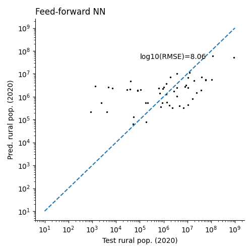{fig-align="center"width="40%"}

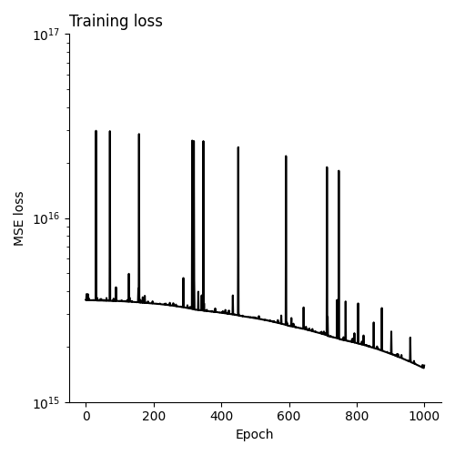{fig-align="center"width="40%"} -->

<br>

<br>

::::{.columns}
:::{.column width="33%"}
{fig-align="center"}
:::
:::{.column width="33%"}
{fig-align="center"}
:::
:::{.column width="33%"}
{fig-align="center"}
:::
::::

## Torch OOP interface

:::{.small}
:::{.center}

``` python
import torch
import torch.nn as nn
import torch.nn.functional as F
class CNN(nn.Module):
    def __init__(self):
        super().__init__()
        # 1 input image channel, 6 output channels, 5x5 square convolution
        # kernel
        self.conv1 = nn.Conv2d(1, 6, 5)
        self.conv2 = nn.Conv2d(6, 16, 5)
        # an affine operation: y = Wx + b
        self.fc1 = nn.Linear(16 * 5 * 5, 120)  # 5*5 from image dimension
        self.fc2 = nn.Linear(120, 84)
        self.fc3 = nn.Linear(84, 10)

    def forward(self, input):
        # Convolution layer C1: 1 input image channel, 6 output channels,
        # 5x5 square convolution, it uses RELU activation function, and
        # outputs a Tensor with size (N, 6, 28, 28), where N is the size of the batch
        c1 = F.relu(self.conv1(input))
        # Subsampling layer S2: 2x2 grid, purely functional,
        # this layer does not have any parameter, and outputs a (N, 6, 14, 14) Tensor
        s2 = F.max_pool2d(c1, (2, 2))
        # Convolution layer C3: 6 input channels, 16 output channels,
        # 5x5 square convolution, it uses RELU activation function, and
        # outputs a (N, 16, 10, 10) Tensor
        c3 = F.relu(self.conv2(s2))
        # Subsampling layer S4: 2x2 grid, purely functional,
        # this layer does not have any parameter, and outputs a (N, 16, 5, 5) Tensor
        s4 = F.max_pool2d(c3, 2)
        # Flatten operation: purely functional, outputs a (N, 400) Tensor
        s4 = torch.flatten(s4, 1)
        # Fully connected layer F5: (N, 400) Tensor input,
        # and outputs a (N, 120) Tensor, it uses RELU activation function
        f5 = F.relu(self.fc1(s4))
        # Fully connected layer F6: (N, 120) Tensor input,
        # and outputs a (N, 84) Tensor, it uses RELU activation function
        f6 = F.relu(self.fc2(f5))
        # Fully connected layer OUTPUT: (N, 84) Tensor input, and
        # outputs a (N, 10) Tensor
        output = self.fc3(f6)
        return output
net = Net()
```

:::
:::


## Hugging face

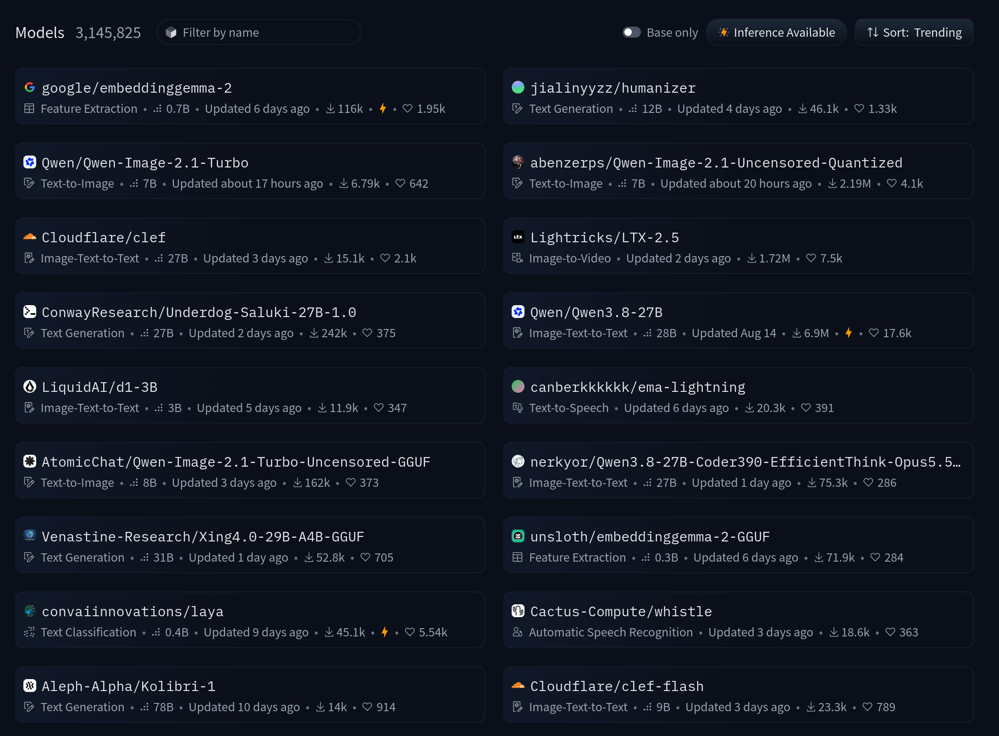{fig-align="center"}

## Class activity

:::{.center}

<br>

[Kaggle breast-cancer-gene-expression-profiles-metabric](https://www.kaggle.com/datasets/raghadalharbi/breast-cancer-gene-expression-profiles-metabric)

Or, use hugging face model and dataset

<br>

:::{.small}

Email 1 slide/image to jacob.krol@colorado.edu by 1:40p Thu.

- Hypothesis (1 sentence)
- Use classification, regression, or clustering to test hypothesis
- 3 analysis figures
- Link to code and documentation
- Present?

:::
:::


## FCQ class 1


{fig-align="center"}

<!-- https://docs.google.com/forms/d/e/1FAIpQLScYp0mvAUwnOR4WXg4QdHWcE4ewgCt7LmiVNI3tjQvidQF9mg/viewform?usp=dialog -->

## In-class assignment

<br>

<br>


:::{.center}
:::{.small}

Workflow: hypothesis > approach > code > analysis

- Figure 1: data exploration (e.g., show high variance genes)
- Figure 2: model selection (e.g., which model best predicts Y from X)
- Figure 3: model inspection (e.g., model coefficients or feature importance)

<br>

Example code: https://github.com/jakekrol/teaching/blob/main/2026_10-swefs/src/breast-cancer-rna-analysis.py

:::
:::

## Example

:::{.center}
:::{.small}
Hypothesis: gene expression can classify ER+/- breast cancer cases

<br>

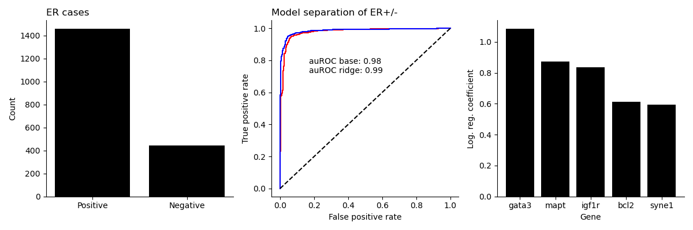{fig-align="center"}
:::
:::

## Corroborating literature

<br>

:::{.center}
"GATA3 is a transcription factor used as a breast cancer marker because it is strongly linked to estrogen receptor (ER)-positive tumors and luminal subtypes, where higher expression often indicates better prognosis. Studies show GATA3 is detected in about 32% of invasive breast cancers and is almost exclusively found in ER-positive cases, correlating with lower tumor grade and improved survival outcomes."
:::

## FCQ class 2

{fig-align="center"}


